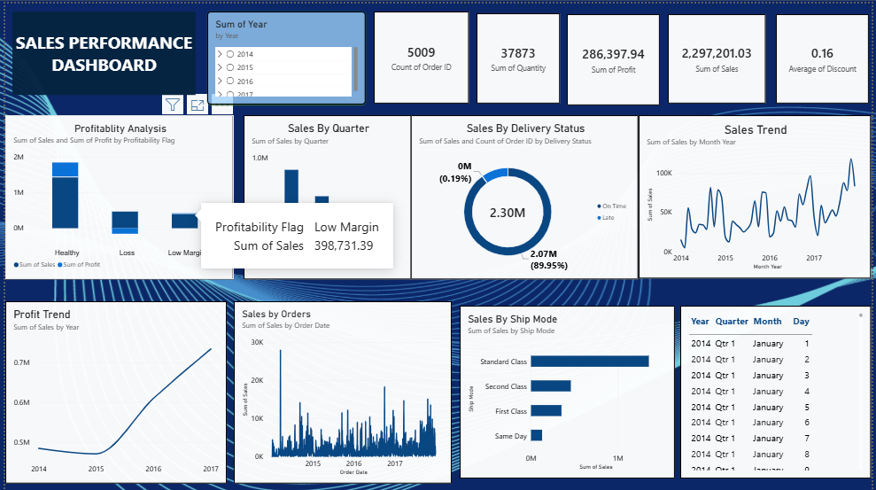

# Sales Performance Dashboard

## Dashboard Preview

## Project Overview

This project presents a Sales Performance Dashboard created using
**Power BI and Microsoft Excel**. It provides an overview of sales,
profit, order volume, quantity, discounts, delivery performance, and
sales trends to support business reporting and analysis.

## Key Metrics

-   **Count of Orders:** 5,009
-   **Total Quantity:** 37,873
-   **Total Profit:** 286,397.94
-   **Total Sales:** 2,297,201.03
-   **Average Discount:** 0.16

## Dashboard Features

-   **KPI Summary:** Tracks order count, quantity, profit, sales, and
    average discount.
-   **Profitability Analysis:** Compares sales and profit across
    Healthy, Loss, and Low Margin categories.
-   **Quarterly Sales:** Shows sales performance by quarter.
-   **Delivery Status:** Compares on-time and late deliveries.
-   **Sales Trend:** Displays monthly sales movement across years.
-   **Profit Trend:** Tracks yearly profit performance.
-   **Sales by Orders:** Visualizes sales across order dates.
-   **Sales by Ship Mode:** Compares sales across Standard Class, Second
    Class, First Class, and Same Day delivery.
-   **Year Filter:** Allows the report to be explored by year.

## Tools & Technologies

-   Microsoft Power BI
-   Microsoft Excel
-   Data Analysis
-   Data Visualization
-   KPI Reporting
-   Charts, Tables, and Filters

## Project Objective

To turn sales data into an easy-to-understand interactive report,
monitor key performance indicators, identify sales and profitability
patterns, and support data-driven business decisions.

## How to Use

1.  Download or clone this repository.
2.  Open the Power BI report file (`.pbix`) in Power BI Desktop, if
    included.
3.  Use the year slicer and report visuals to explore the sales
    performance data.

## Author

Created as a portfolio project demonstrating sales analysis, dashboard
development, and MIS reporting using Power BI and Excel.
